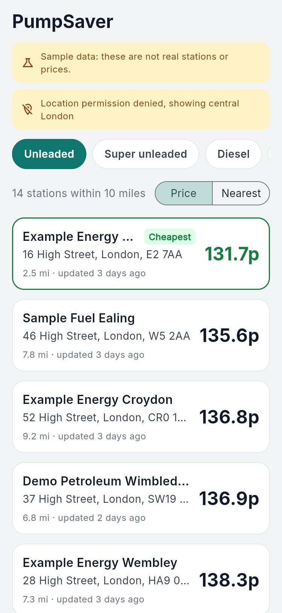
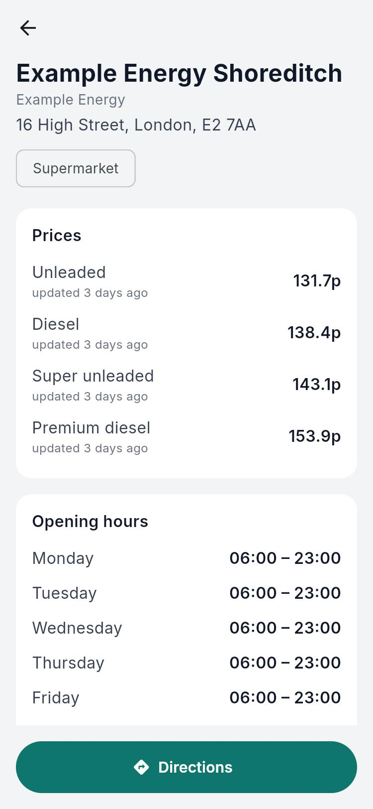

# PumpSaver

Find the cheapest petrol and diesel near you in the UK, using the government's live **Fuel Finder** open data
(every UK forecourt must report price changes within 30 minutes).

Built with Flutter 3.47 and Riverpod 3.

<p>
  
  
</p>

*Screenshots use the bundled sample data.*

## Features

- Nearest stations within 10 miles that sell your fuel (unleaded E10, super unleaded E5, diesel, premium diesel)
- Sort by cheapest or nearest; the cheapest station is highlighted
- How fresh each price is ("updated 25 min ago")
- Station details: every fuel price, opening hours, facilities, one-tap directions
- Remembers your fuel type and sort order
- Works without location permission (falls back to central London and says so)
- Works offline: keeps the last downloaded prices on the device and says how old they are
- No accounts, adverts or analytics ([privacy policy](https://noyon04.github.io/PumpSaver/privacy.html))

## Architecture

```
Fuel Finder API ──(OAuth client credentials, rate-limited, paged, UK traffic only)──┐
                                                                                   │  every 30 min, UK machine
                                                             tool/fetch_fuel_data.dart
                                                                                   │  merges stations + prices,
                                                                                   │  keeps only fields the app uses
                                                    gh-pages branch → GitHub Pages: stations.json (~1.2 MB gzipped)
                                                                                   │  one GET
                                                                            Flutter app
```

The API needs a client secret and allows about one request every 2 seconds, so phones can't call it directly.
A scheduled job fetches it with the secret held outside the app, and the app downloads a single static file.

The API's CloudFront edge rejects non-UK traffic (403 from GitHub's US-hosted Actions runners), so the job runs
on a UK machine: `tool/publish_from_pc.ps1` via Windows Task Scheduler. It force-pushes a single-commit
`gh-pages` branch so the repo history doesn't grow. A UK-region cloud function (e.g. AWS Lambda in eu-west-2)
is the next step for running it without a PC.

App code follows a feature-first controller / state / view layout:

```
lib/
  constants/     asset paths, shared-preference keys
  controller/    one folder per feature: <name>_controller.dart + state/<name>_state.dart
    stations/    load stations; nearby_stations_controller.dart filters + sorts (pure, unit-tested)
    location/    device location with permission handling and fallback
    search_filter/  fuel type + sort order, persisted
    startup/     what the splash screen loads
  models/        StationModel, FuelPriceModel, FuelType (Fuel Finder field names)
  network/       API endpoints, Network GET + response handling
  services/      app mode (sample vs live), navigation, time formatting
  views/
    global_components/  reusable K-prefixed widgets
    screens/     startup, home (+ components), station_details
    styles/      KColor, KTextStyle, KSize
```

State: each controller is a Riverpod `Notifier` exposing a `sealed` state class (Initial / Loading / Success / Error),
which screens handle with an exhaustive `switch`/`is` check.

## Run it

```bash
flutter pub get
flutter run            # Android / iOS
flutter run -d chrome  # web
```

The app reads live prices from `https://noyon04.github.io/PumpSaver/stations.json`.
To use the **bundled sample data** instead (fictional stations around London, clearly labelled in the app):

```bash
flutter run --dart-define=PRODUCTION_MODE=false
```

To read a local copy (e.g. a phone over USB with `adb reverse tcp:8766 tcp:8766`):

```bash
flutter run --dart-define=LIVE_URL=http://localhost:8766/
```

## Publishing live data

1. Get API credentials: sign in with GOV.UK One Login at the
   [Fuel Finder developer portal](https://www.developer.fuel-finder.service.gov.uk/access-latest-fuelprices).
2. On a UK Windows PC, save them as user environment variables (never in the repo):
   `setx FUEL_FINDER_CLIENT_ID ...` and `setx FUEL_FINDER_CLIENT_SECRET ...`
3. Run `tool/publish_from_pc.ps1` once, then set Settings > Pages > Source to **Deploy from a branch: gh-pages**.
4. Schedule the script every 30 minutes with Task Scheduler. It logs to `F:\Android\tmp\pumpsaver_publish.log`.

## Release build

Create an upload key once (keep the file and passwords safe; neither goes in git):

```bash
keytool -genkey -v -keystore F:\Android\pumpsaver-upload.jks -keyalg RSA -keysize 2048 -validity 10000 -alias upload
```

Then create `android/key.properties`:

```
storeFile=F:/Android/pumpsaver-upload.jks
storePassword=...
keyAlias=upload
keyPassword=...
```

```bash
flutter build appbundle --release
```

Without `key.properties`, release builds are signed with the debug key (fine for testing, rejected by Play).
The launcher icon is generated from `assets/icon/` with `dart run flutter_launcher_icons`.

## Tests

```bash
flutter test
```

Covers the nearby-station filter and sort (closed stations, radius, missing fuel, price and distance order),
parsing of the API field names, time formatting, and the station card widget.

## Data

Contains public sector information licensed under the
[Open Government Licence v3.0](https://www.nationalarchives.gov.uk/doc/open-government-licence/version/3/) (Fuel Finder).
PumpSaver is an independent app, not affiliated with the UK government.
